# 霜月問劍

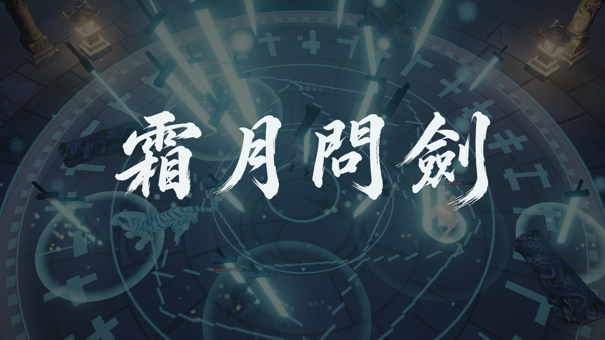

俯視角武俠動作小品，共三關，每關三批小怪加一個會放大招的兩階段 Boss：月夜的廢棄山門演武台、黎明飄雪的寒潭劍塚、雲海之上的雲巔天闕。難度逐關提高，第一關最簡單。three.js 寫成，角色、道具、靈獸都是生成模型。

**線上試玩：<https://malilion.github.io/shuangyue-wenjian/>**（第一次進入需下載約 20MB 資源）

也可以直接雙擊 `dist/shuangyue.html`，不需要伺服器或網路。

## 畫面

| | |
|---|---|
| 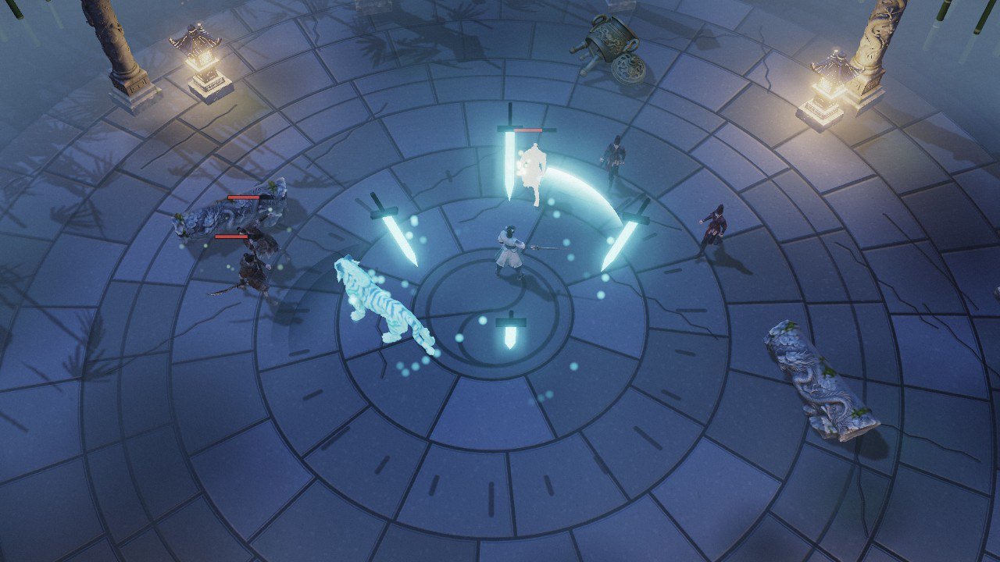 劍陣環身、御劍追魂與靈獸白虎 | 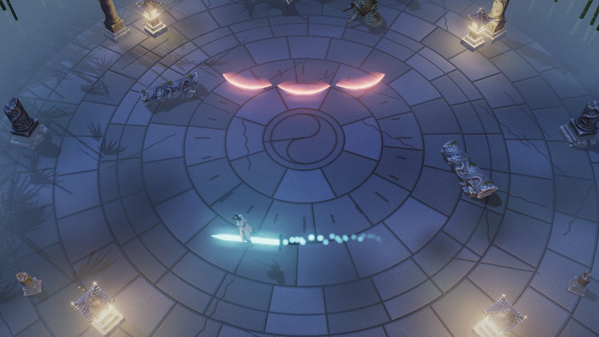 御劍飛行，越過 Boss 的劍氣 |
| 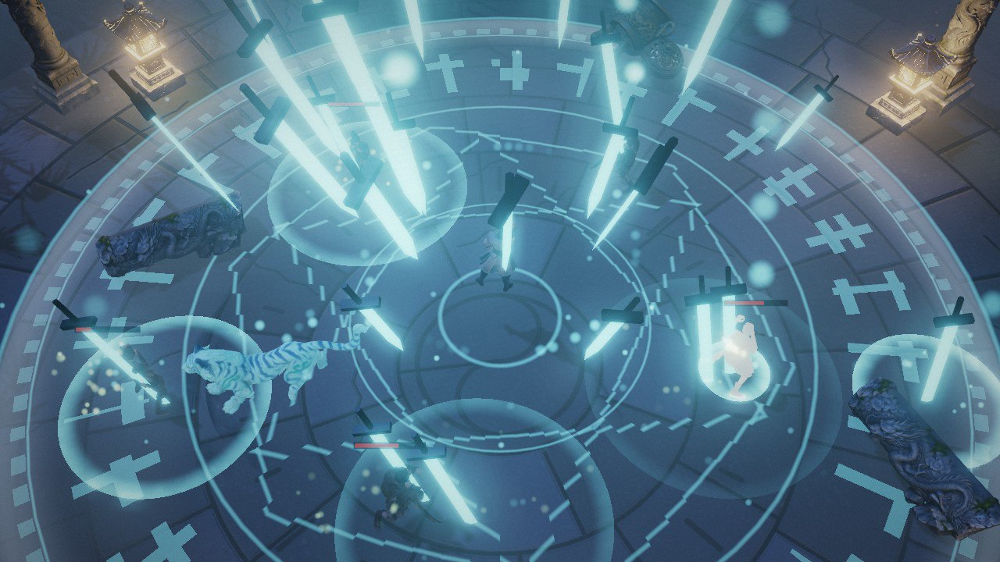 大招「千刃歸月」：月影、法陣、劍雨 | 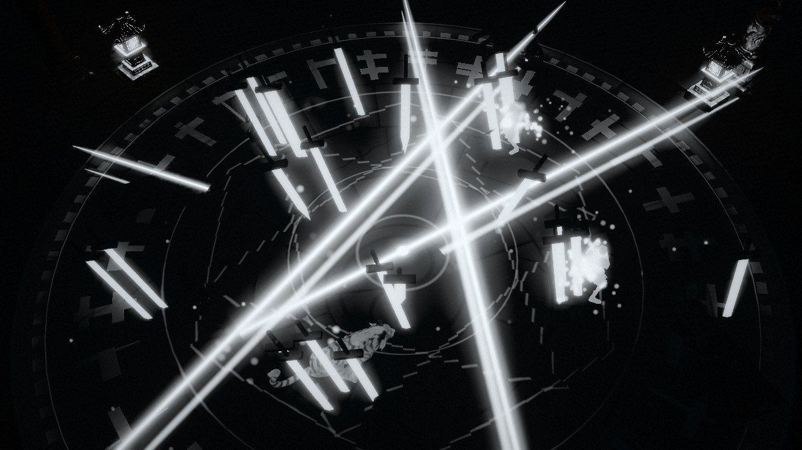 畫面轉黑，只剩刀光 |
| 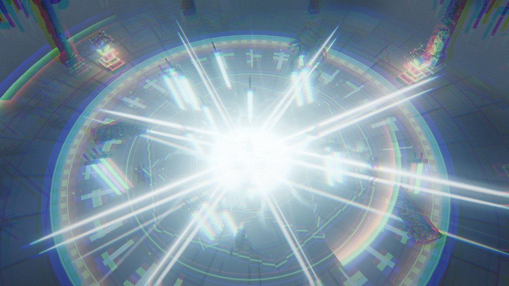 滿月斬收尾 | 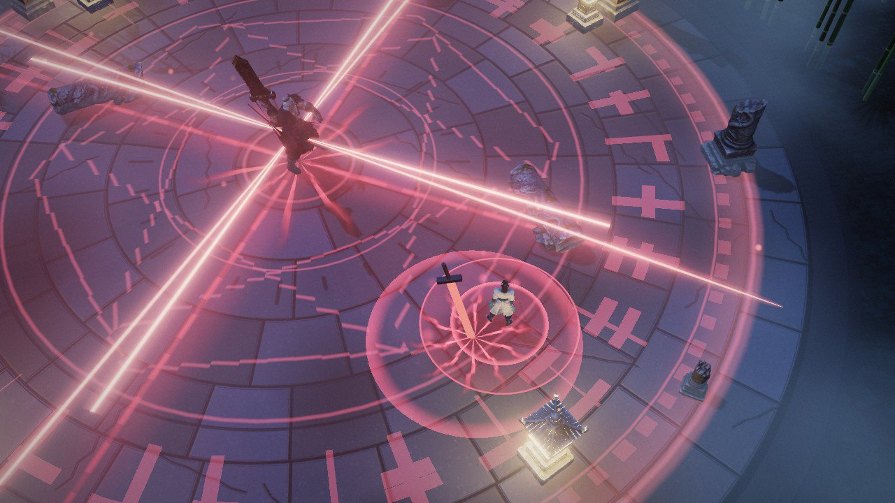 Boss 大招：血月下四道光刃掃場 |

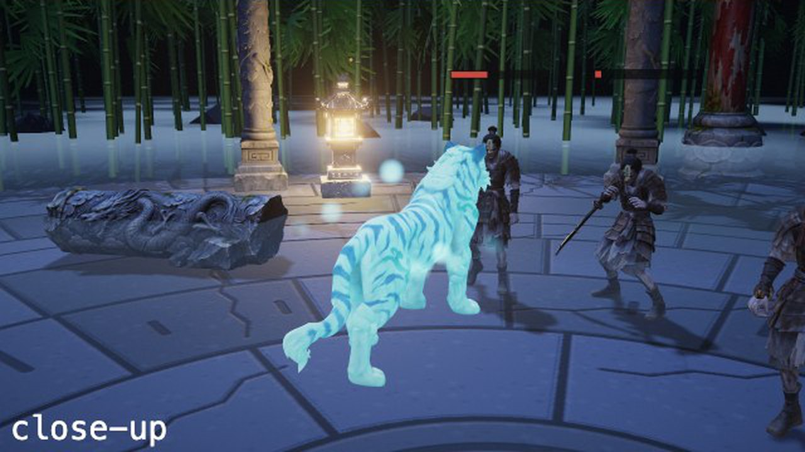

## 操作

| 按鍵 | 動作 |
|---|---|
| W A S D | 移動 |
| 滑鼠左鍵 | 三段斬 |
| 滑鼠右鍵 | 格擋；剛舉劍的瞬間接住是彈反，之後左鍵反擊 |
| 空白鍵 | 閃避 |
| Q | 劍氣（耗真氣） |
| E | 落劍（耗真氣） |
| F | 御劍追魂：三把飛劍自動追敵（耗真氣） |
| C | 劍陣環身：四把劍繞身 6.5 秒，可打掉彈幕（耗真氣） |
| V | 召喚靈獸：白虎助戰 12 秒（耗真氣） |
| 按住 Shift | 御劍飛行（持續耗真氣）；飛行中左鍵俯衝突刺 |
| R | 大招「千刃歸月」（劍意滿時） |
| F3 | 除錯面板 |

真氣隨時間回復、命中時增加；劍意靠命中、彈反、完美閃避累積。

### 手機

手機和平板可以直接玩，**必須橫向**（直向時會提示轉向並暫停）。左半邊任意處按住拖曳是搖桿，右下角的技能圖示就是按鈕（格擋和御劍飛行是按住），沒有滑鼠所以自動瞄準最近的敵人。網址加 `?touch` 可在電腦上強制觸控模式測試。

## 第一關 Boss：厲無咎

- 三連斬，第三刀劈出劍氣
- 躍起砸地（不可格擋）
- 瞬步斬：先在地上標出一條線，下一瞬人已在線的另一端
- 扇形劍氣
- 半血後：天降劍雨，出招變快
- 剩三成血時放一次大招：躍回台心，血月之下四道光刃掃過全場並中途反轉，劍雨追人，最後一把巨劍天降。放完會力竭數秒，是收掉他的時機。

## 第二關：寒潭劍塚

打倒厲無咎後轉場進入。結冰的寒潭上插滿殘劍，黎明、飄雪。

| | | |
|---|---|---|
| 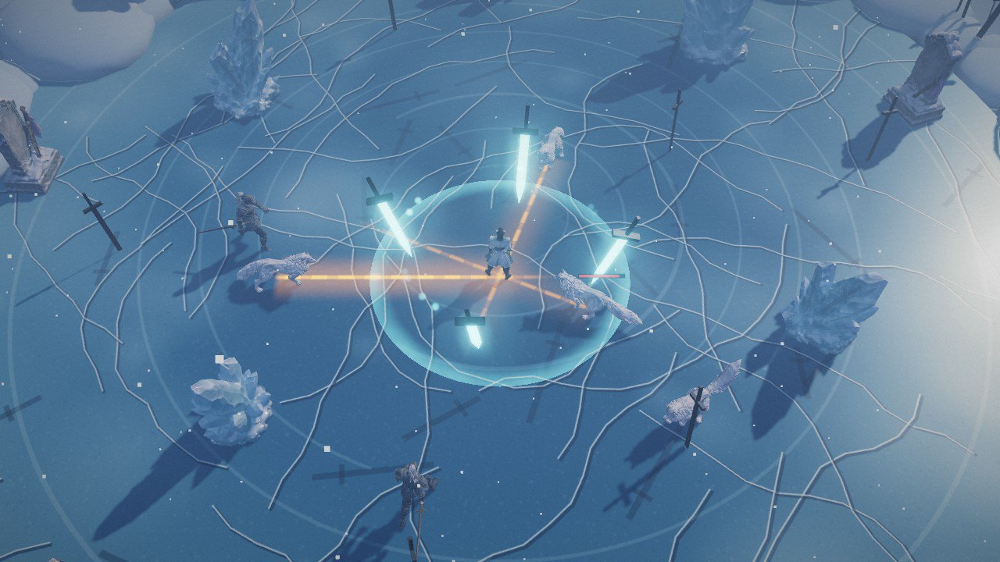 雪狼撲擊前的預警線 | 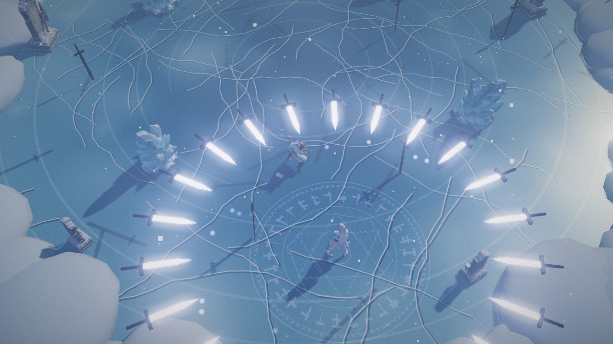 霜晚的劍環 | 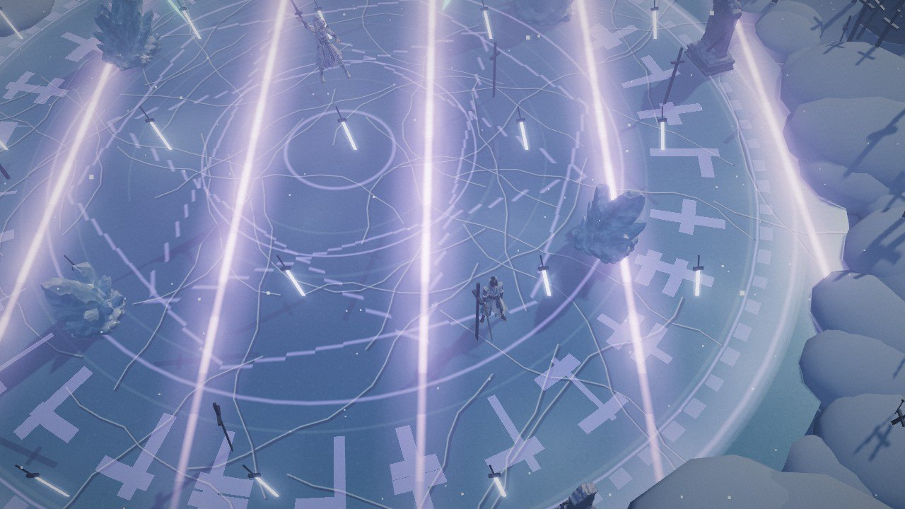 霜晚大招：隔行劍雨 |

- **雪狼**：四足，繞圈後在地上標出一條線，沿線撲擊。
- **冰魄劍靈**：兩刀，第二刀劈出冰刃。
- **霜符傀**：一次射出三發扇形彈幕。

### Boss：霜晚

守塚的女劍仙，保持距離用飛劍作戰。

- 飛劍連射：一串飛劍，每一把都瞄準出手當下你的位置（可以砍掉或彈反）
- 劍環：一圈劍向外擴散，要抓時機閃過去
- 瞬移斬：消失後出現在你背後，兩刀
- 半血後：天降冰劍，劍環變成兩道
- 剩三成血時放一次大招：騰空於台心，一排排劍雨隔行落下、橫豎交替、越來越快，最後連放三道劍環。落地後力竭數秒。

## 第三關：雲巔天闕

打倒霜晚後進入。雲海之上的白玉平台，金色黃昏；Boss 進入二階段後轉為雷暴。

| | | |
|---|---|---|
| 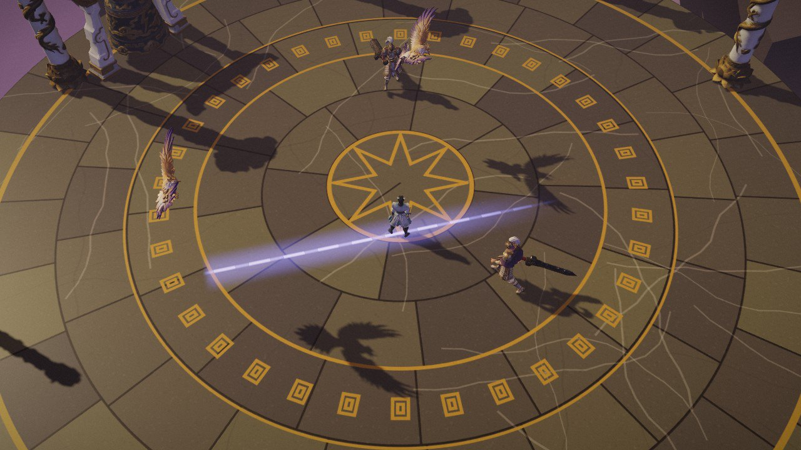 雷鷹俯衝前的預警線 | 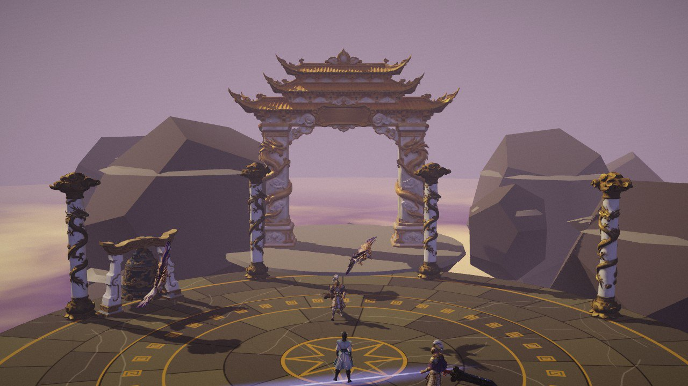 天闕門與盤龍玉柱 | 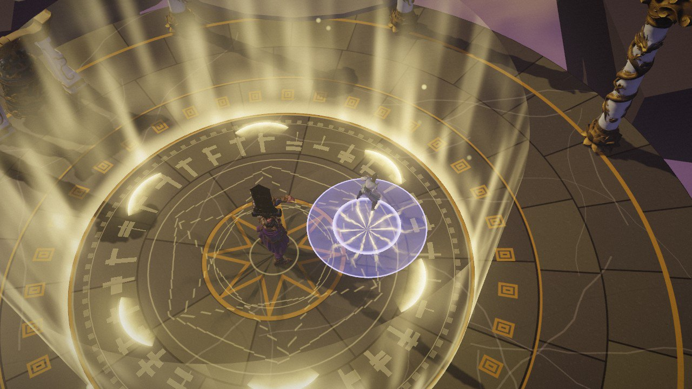 玄霄大招：雷牢 |

- **天兵**：先沿一條線長刺，再橫掃。
- **雷鷹**：在頭頂盤旋，標出一條線後俯衝。
- **雷符道人**：在你站的位置連召兩道落雷。

### Boss：玄霄

天闕之主，使巨劍與雷。

- 三連斬：每一刀之後有一排落雷沿刀勢向外走
- 連鎖雷：一道接一道追著你落
- 三連瞬步：連續三次沿線突進，每次重新瞄準
- 扇形劍氣（二階段連發兩輪）
- 半血後：雷暴，全場隨機落雷
- 剩三成血時放一次大招：躍回台心，一圈雷牢從全場收縮到台心並維持住，牢外會持續受傷；牢內有落雷追人、六向劍氣從他身上散開，最後一道巨雷。之後力竭數秒。

網址加 `?stage=2`、`?stage=3` 直接進該關，`?stage=boss2`、`?stage=boss3` 直接打該關 Boss。

## 開發

```bash
npm install
node serve.mjs          # http://localhost:5173
node tools/build.mjs    # 產生 dist/shuangyue.html（單檔）與 dist/site/（線上站點）
```

網址參數：`?auto` 跳過標題、`?mute` 靜音、`?god` 無敵、`?stage=boss` 直接打 Boss、`?ult` 大招滿能量、`?standin` 不載模型。

**原始模型不在 repo 裡**（26 個檔案共約 330MB）。沒有模型時遊戲會退回幾何體替身，仍可運行；要重建完整版，依 `assets/generations.json` 的生成編號從 Hyper3D 重新下載到 `assets/models/`。`dist/shuangyue.html` 與線上站點已內含壓縮後的模型。

線上站點是 `dist/site/` 的內容，放在 `gh-pages` 分支。

## 素材來源

- 角色、武器、場景道具、靈獸：Hyper3D Rodin 生成（編號見 `assets/generations.json`），設定圖在 `concept/`。
- 音效：OpenGameArt 上的 CC0 音效包，見 `assets/sfx/SOURCES.md`。
- 配樂：Google Flow Music 生成，見 `assets/music/SOURCES.md`。對外發佈前請確認其使用條款。
- 標題字與技能圖示：圖像模型生成後裁切。

`src/input.js`、`serve.mjs` 與打包腳本改自 guizang-game-skill（AGPL-3.0）。
